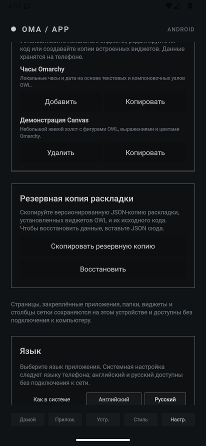
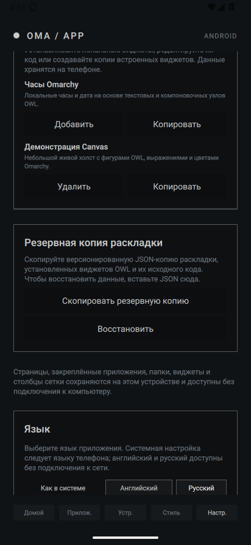
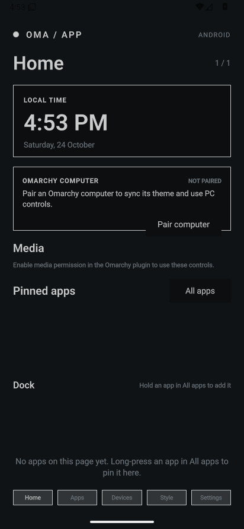
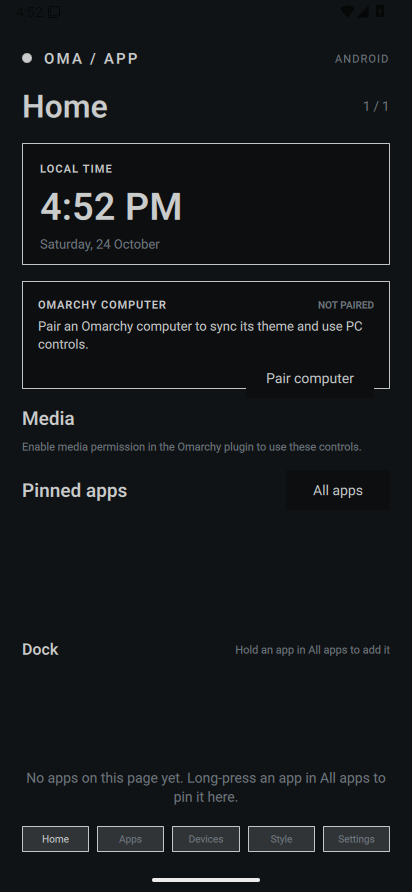

# OmaApp — One Shell. Every Device.

 · [English](README.md) · [Русский](README_RU.md)

OmaApp is an Android launcher and direct Omarchy companion, built with Qt Quick. It pairs directly with one Omarchy plugin and keeps launcher data and cached appearance available offline. Physical Pixel/GrapheneOS verification remains.

## Current state

- The Android app uses Qt 6.10+ / C++ / QML and includes a local Home screen with up to five swipeable pages, a pinned-app dock, full Android launcher icons, app search, folders, adjustable 3–5 column grid, and settings for the live clock/computer/media cards. Pinned apps can be moved between pages or removed with a long press. Android launcher data stays local, and the optional HOME activity works without an Omarchy computer.
- Pairing is a direct HTTPS connection to the one Omarchy plugin. The first pairing requires approval in OmaApp and in the plugin; the client pins the QR's computer certificate and keeps its bearer token encrypted with Android Keystore.
- After QR trust is established, foreground DNS-SD discovery can find the same trusted plugin after a local IP change. It advertises only the public certificate fingerprint; OmaApp still verifies the pinned TLS certificate and stored token before updating an address.
- The plugin reads active Omarchy colors, `shell.toml`, wallpaper, Hyprland border gradients, rounding, rounding power, gaps, animations, and Bezier curves. Theme/configuration and workspace events are event-driven; a slower 30-second foreground refresh covers metrics and missed events. OmaApp keeps the last successful theme while offline.
- Clipboard, file transfer, MPRIS, system metrics, Hyprland workspace switching, and configured user commands are available behind independent per-device permissions. Clipboard is tapped and foreground-only; files use Android's system picker and a 100 MiB limit; arbitrary shell commands are never accepted.
- Home supports drag and drop between pages and the dock, dynamic Android app shortcuts, configurable gestures, and local backup/restore. It includes an offline OWL widget store/editor, an embedded copy of the original OWL compiler/runtime, and an OWL Canvas renderer for bounded local widgets. Android apps, widget sources and layout backups stay usable without the computer.
- Optional Home haptics use Android's system-respecting `View.performHapticFeedback` API for app launches and Home editing. They are off by default, saved locally, included in layout backups, and remain subject to Android's touch-feedback settings.
- English and Russian UI are available offline, with Android language detection and an in-app language selector. App installs and removals refresh the launcher model from Android package events.
- CI also exercises a real Android `AppWidgetHost` binding and interactive host view over QtActivity. This is a proof of concept only; ordinary Android widgets are not yet integrated into saved Home layouts.
- OWL currently runs an offline subset: layout/text/basic controls plus Canvas shapes, paths, transforms, clipping and gradients. Widgets requiring shell commands, network, assets, background triggers, interactive handlers, secrets or sampled state are rejected with an editor error instead of being run.
- The desktop target is a preview. It does not fake an installed-app list.
- The listener starts when pairing is requested or saved devices are present. The Python helper and QR encoder are files inside the one plugin; no extra product or system service is installed.
- OmaApp does not install Arch Linux ARM or PRoot. It does not bundle the Quickshell executable or Linux/Wayland modules into the APK.
- This development iteration improves DNS-SD address changes across active IPv4 interfaces, refreshes mDNS memberships after interface changes, uses Android's service-info updates on API 34+ and Android 13 T extension 7+ with a legacy fallback, and drains rediscovery after active network work finishes. It also checks Android text scaling, repeated locale switches, QML binding loops, and records Android/Qt stage diagnostics when HOME readiness times out. Check the current build and emulator results in [GitHub Actions](https://github.com/pluseight8/omarchy-app-mobile/actions/workflows/ci.yml). The CI APK is a test artifact; this iteration does not claim a signed release.
- No Quickshell executable or library is included. The Android app uses Qt Quick; the Omarchy plugin runs inside Quickshell.

The local suite passes 133 Python tests and validates 292 Russian UI strings. CI #250 (https://github.com/pluseight8/omarchy-app-mobile/actions/runs/40192392591) passed Desktop and arm64. Both emulator backends reached Qt Quick and passed launcher, locale, process-persistence, app-discovery, and haptics checks, then failed only because the Settings screenshot baseline did not include the relocated OWL creation button. This change refreshes the OpenGL and Vulkan Settings baselines without relaxing the visual threshold; full follow-up CI is pending. CI #249's OpenGL HOME timeout occurred before native main/QML and showed no crash or ANR; both backends launched the UI in #250, so the earlier cause remains unknown. Earlier runs exercised pairing/reconnect and permission revocation; the current #250 run stopped before those later steps. The Russian Settings screenshots below are from run #201. The plugin was installed and restarted earlier in a real Omarchy 4.0.4 / Quickshell 0.3.1 session, but Android DNS-SD against a live Omarchy host has not been exercised end to end. This workspace lacks CMake, Qt ShaderTools, and the Android/JDK toolchain for local full builds. No Pixel device is attached, so Pixel 10 / GrapheneOS behavior remains unverified.

### Emulator screenshots

The Russian Settings screen was captured at 412 × 892 in each emulator graphics backend during CI run #201.

## Build the desktop preview

Requirements: CMake 3.24+, Ninja, a Qt 6.10+ SDK with Qt Quick Controls 2, Qt ShaderTools, and Qt Test, and a C++17 compiler.

    cmake -S . -B build/desktop -GNinja -DCMAKE_BUILD_TYPE=Debug
    cmake --build build/desktop
    ctest --test-dir build/desktop --output-on-failure

Run the generated `omaapp` executable to inspect the launcher shell and GPU-rendered rounding preview.

## Build an Android APK

The Android target uses Qt for Android arm64, JDK 17, Android SDK 36, and NDK 27.2.12479018. GitHub Actions installs this toolchain and builds the APK artifact.

For a local build, configure CMake with the Qt Android arm64 kit and the Android SDK/NDK paths, then build the apk target:

    qt-cmake -S . -B build/android -GNinja -DANDROID_SDK_ROOT=/path/to/Android/Sdk -DANDROID_NDK_ROOT=/path/to/Android/Sdk/ndk/27.2.12479018
    cmake --build build/android --target apk

See the [Pixel 10 + GrapheneOS installation and test guide](docs/GRAPHENEOS.md). The current commit has not yet been installed on a physical phone.

## Install the Omarchy plugin

From a checkout of this repository on an Omarchy computer:

    ./omarchy-plugin/install.sh

The installer checks Python 3.11+, OpenSSL, and Omarchy, then validates and copies the single plugin into the Omarchy user plugin directory. The plugin owns its helper process and does not install a separate server or system service. Pairing and install notes are in [the plugin guide](omarchy-plugin/README.md) and [the protocol status](docs/PAIRING.md).

## Plan and limits

See [architecture](docs/ARCHITECTURE.md), [installation](docs/INSTALLATION.md), [pairing and sync](docs/PAIRING.md), [GrapheneOS status](docs/GRAPHENEOS.md), [compatibility findings](docs/compatibility.md), [the threat model](docs/threat-model.md), and [the implementation plan](tasks/plan.md). The first test release is configured as a GitHub Pre-release and requires the repository owner's signing secrets; the workflow publishes no APK if those secrets are absent.

OmaApp is an independent project and is not an official Omarchy product.

## Special Mention

OmaApp builds upon the original Omalauncher project created by Simon Schubert. His work provided the original foundation for this project, and we gratefully acknowledge his contribution to the open-source community.

Original project: [SimonSchubert/omalauncher](https://github.com/SimonSchubert/omalauncher)
Original author: [Simon Schubert](https://github.com/SimonSchubert)
