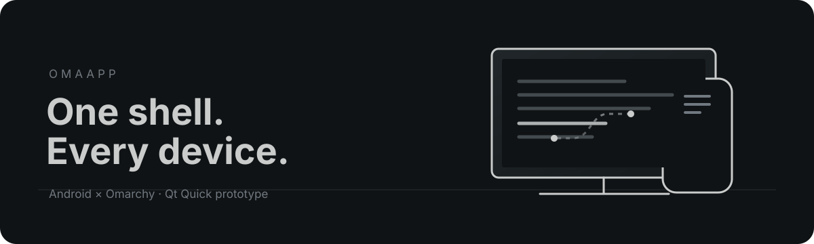

# OmaApp — One Shell. Every Device.

 · [English](README.md) · [Русский](README_RU.md)

OmaApp — Android-лаунчер и прямой компаньон Omarchy на Qt Quick. Сборки и сценарий защищённого сопряжения с синхронизацией темы проходят CI и проверены на эмуляторе Android x86_64; проверка на физическом устройстве ещё предстоит.

## Текущее состояние

- Android-приложение использует Qt 6.10+, C++ и QML. Оно получает список launcher-активностей, запускает приложения, показывает системные иконки, сохраняет закреплённые активности и папки приложений, может быть выбрано домашним экраном Android и содержит сканер QR-кода с разрешением камеры по запросу.
- Сопряжение выполняется напрямую по HTTPS с одним плагином Omarchy. При первом сопряжении нужно подтвердить компьютер в OmaApp и телефон в плагине; приложение закрепляет сертификат компьютера из QR-кода и хранит токен в Android Keystore.
- Плагин читает активную тему Omarchy и поддерживаемую геометрию Hyprland: цвета, градиент активной рамки, обои, толщину рамки, скругление, силу скругления и интервалы. OmaApp обновляет снимок каждые четыре секунды и хранит последнюю тему для автономного режима.
- Настольная версия — только предпросмотр. Список приложений на ней не подменяется фиктивными данными.
- Сетевой слушатель запускается при запросе QR-кода или наличии сохранённых устройств. Python-помощник и генератор QR входят в состав одного плагина; отдельная программа или системная служба не устанавливаются.
- Удалённые команды, буфер обмена, обмен файлами, медиа, уведомления, управление рабочими столами, терминал и трансляция рабочего стола пока не реализованы.
- CI собирает отладочный arm64 APK и проверяет на эмуляторе x86_64 установку, выбор HOME, список и запуск приложений, сохранение закреплённых приложений и папок, TLS-сопряжение, синхронизацию темы и обоев, переподключение и отзыв токена ([run 44 пройден](https://github.com/pluseight8/omarchy-app-mobile/actions/runs/39610588557)). Отладочный APK не является подписанным релизом; подписанный релиз пока не опубликован.
- В Android-приложение не включён Quickshell: приложение использует Qt Quick, а плагин Omarchy исполняется внутри Quickshell.

В локальном окружении есть настольные инструменты Qt 6.11.2, `qmllint` и `adb`, но нет CMake, JDK, Android SDK, эмулятора и подключённого Android-устройства. GitHub Actions собирает arm64 debug APK и запускает Android smoke test.

## Сборка настольного предпросмотра

Нужны CMake 3.24+, Ninja, Qt 6.10+ с Qt Quick Controls 2, Qt ShaderTools и Qt Test, а также C++17.

    cmake -S . -B build/desktop -GNinja -DCMAKE_BUILD_TYPE=Debug
    cmake --build build/desktop
    ctest --test-dir build/desktop --output-on-failure

Запустите созданный executable `omaapp`, чтобы открыть оболочку и GPU-предпросмотр скруглений.

## Сборка Android APK

Android-цель использует Qt for Android arm64, JDK 17, Android SDK 36 и NDK 27.2.12479018. GitHub Actions устанавливает этот toolchain и собирает APK.

Для локальной сборки настройте CMake с Qt Android arm64 и путями к Android SDK/NDK, затем соберите цель apk:

    qt-cmake -S . -B build/android -GNinja -DANDROID_SDK_ROOT=/path/to/Android/Sdk -DANDROID_NDK_ROOT=/path/to/Android/Sdk/ndk/27.2.12479018
    cmake --build build/android --target apk

Прототип ещё не установлен на GrapheneOS или устройство Pixel. Первый APK пока не опубликован в Releases.

## Установка плагина Omarchy

В клоне репозитория на компьютере с Omarchy выполните:

    ./omarchy-plugin/install.sh

Установщик проверяет Python 3.11+, OpenSSL и Omarchy, затем проверяет манифест и копирует один плагин в пользовательский каталог Omarchy. Вспомогательный процесс принадлежит этому плагину; отдельный сервер или системная служба не устанавливаются. Инструкции по сопряжению — в [руководстве плагина](omarchy-plugin/README_RU.md) и [описании протокола](docs/PAIRING.md).

## План и ограничения

См. [архитектуру](docs/ARCHITECTURE.md), [инструкцию установки](docs/INSTALLATION.md), [сопряжение и синхронизацию](docs/PAIRING.md), [статус GrapheneOS](docs/GRAPHENEOS.md), [совместимость](docs/compatibility.md), [модель угроз](docs/threat-model.md) и [план реализации](tasks/plan.md). Первый тестовый релиз настроен как GitHub Pre-release и требует секретов подписи, принадлежащих владельцу репозитория; без них workflow не публикует APK.

OmaApp — независимый проект, не являющийся официальным продуктом Omarchy.

## Special Mention / Специальное упоминание

OmaApp builds upon the original Omalauncher project created by Simon Schubert. His work provided the original foundation for this project, and we gratefully acknowledge his contribution to the open-source community.

Исходный проект: [SimonSchubert/omalauncher](https://github.com/SimonSchubert/omalauncher)
Автор исходного проекта: [Simon Schubert](https://github.com/SimonSchubert)
